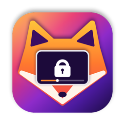

# PiP Lock

A small macOS menu bar app that locks Picture-in-Picture windows from any app: Firefox, Chrome, Edge, Safari, Teams and so on. Once it's locked, you can't drag it, resize it or click it by accident, and the video keeps playing.

It works by laying an invisible window over every always-on-top window, so it also locks other apps' floating windows while it's on. There's no installer, it needs no permissions.

## Install

Download the zip, unzip it and move **PiP Lock** to Applications. The app isn't notarized by Apple, so macOS blocks it the first time you open it. Go to **System Settings → Privacy & Security** and click **Open Anyway**. You only have to do that once.

## Use

Click the lock in the menu bar, or press **⌃ ⌥ L** from any app. Do the same again to unlock.

## Build it yourself

You need Apple's command line tools (`xcode-select --install`). Then run `./scripts/build.sh`, and the app ends up in `build/`.

MIT license. Not affiliated with Mozilla, Google, Microsoft or Apple.
